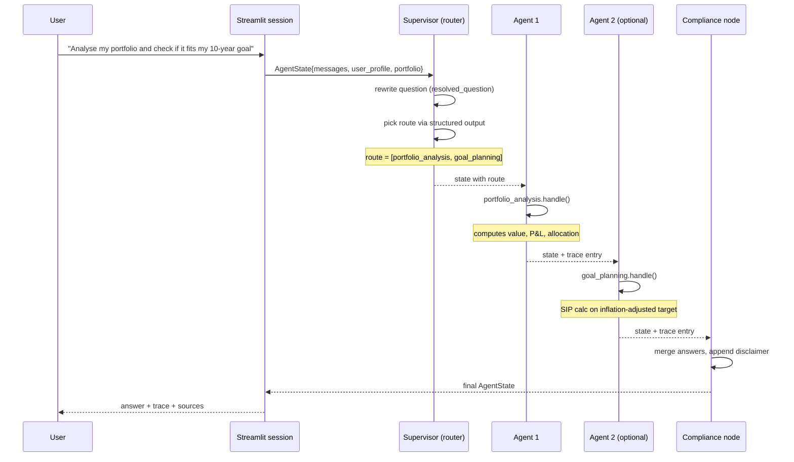
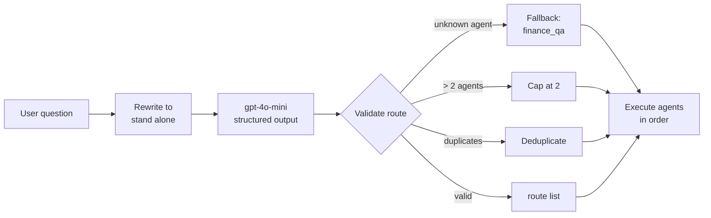
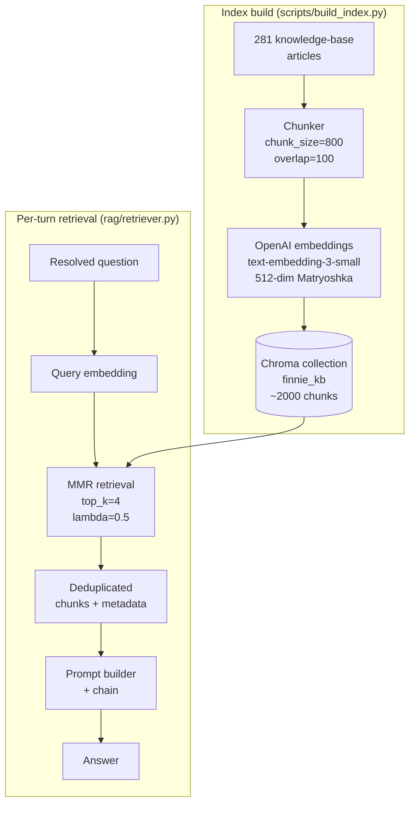
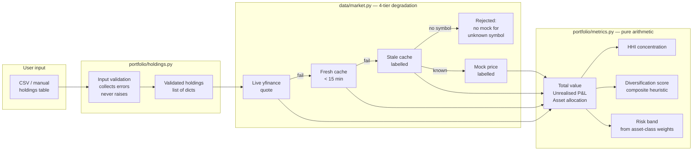
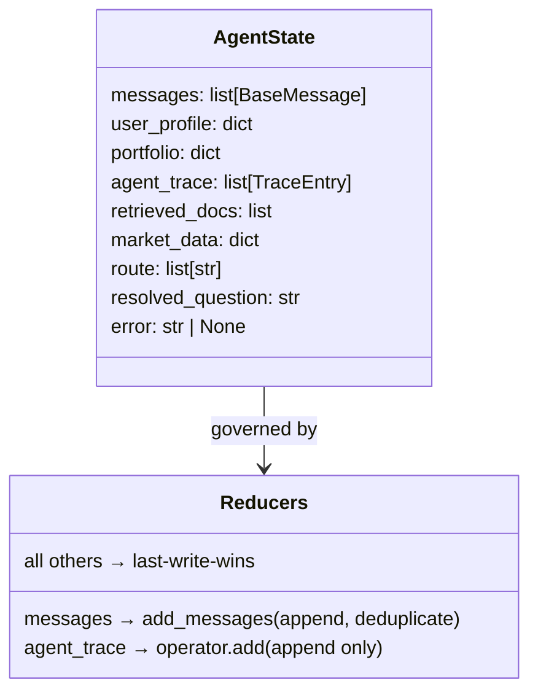
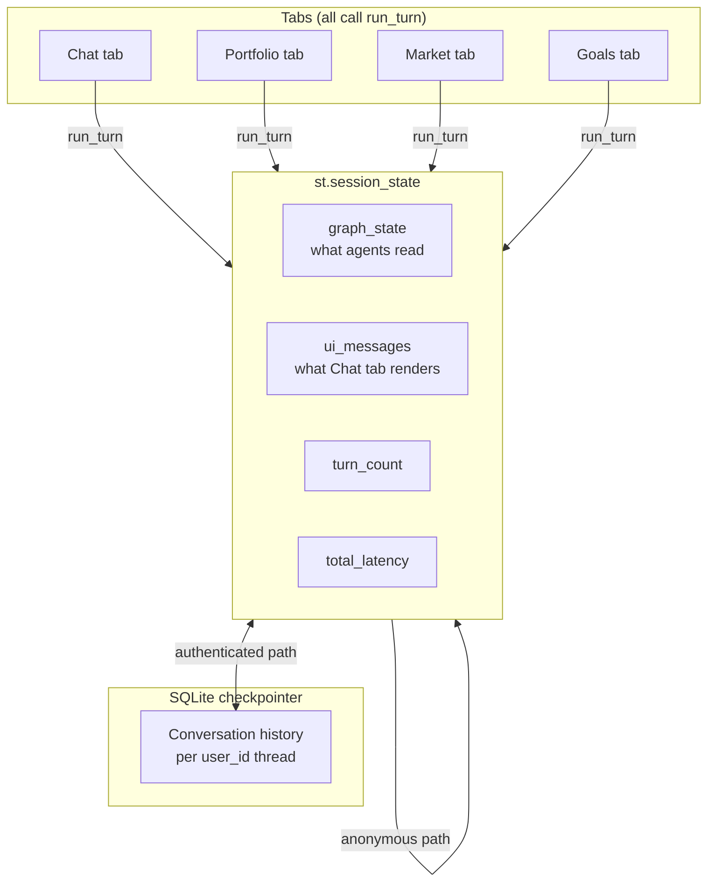
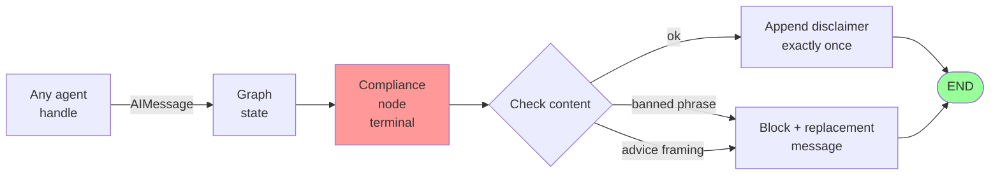

# Finnie — Design Document

Architecture, data flow, and design decisions for the multi-agent finance assistant.

---

## 1. System Architecture

```mermaid
graph TB
    subgraph UI ["Streamlit UI (app.py)"]
        CT[💬 Chat tab]
        PT[📊 Portfolio tab]
        MT[📈 Market tab]
        GT[🎯 Goals tab]
        NT[📰 News tab]
        TT[🧾 Tax tab]
    end

    subgraph Session ["web_app/session.py"]
        RT[run_turn]
        SS[session state]
    end

    subgraph Graph ["LangGraph StateGraph"]
        SV[Supervisor\nrouter]
        A1[Agent 1]
        A2[Agent 2]
        CN[Compliance\nnode]
    end

    subgraph Agents ["src/agents/"]
        QA[finance_qa]
        MA[market_analysis]
        SD[stock_deep_dive]
        PA[portfolio_analysis]
        GP[goal_planning]
        NW[news_synthesizer]
        TX[tax_education]
    end

    subgraph Data ["Data sources"]
        KB[(Chroma\nknowledge base\n2000 chunks)]
        YF[yfinance\nNSE/BSE data]
        AV[Alpha Vantage\nfallback]
        DB[(SQLite\nuser accounts\n+ checkpoints)]
    end

    CT & PT & MT & GT & NT & TT --> RT
    RT --> SS
    SS --> Graph
    SV -->|route: [agent1]| A1
    SV -->|route: [agent1, agent2]| A1 --> A2
    A1 & A2 --> CN
    CN --> SS

    QA & TX -->|MMR retrieval| KB
    MA & SD & NW -->|quotes / news| YF
    YF -->|rate limit| AV
    PA -->|holdings + prices| YF
    GP -->|pure arithmetic| GP

    SS <-->|checkpointer| DB
    UI <-->|auth| DB
```

---

## 2. LangGraph Execution Flow



---

## 3. Agent Router (Supervisor)



The supervisor also **rewrites** the user's question before routing — "What about the second one?" becomes the full resolved question using conversation history. Agents receive the rewritten question via `BaseAgent._latest_question()`, which prefers `resolved_question` over the raw message.

**Router gate:** 91.1% strict accuracy on 45 labelled queries (FR-002 requires ≥ 90%).

---

## 4. RAG Pipeline



**Why 512-dim Matryoshka?** OpenAI's `text-embedding-3-small` supports dimension truncation. At 512 dims (vs 1536 full): 67% smaller index, <5% quality loss on MTEB benchmarks, ~$0.01 per full re-index.

**Why MMR?** Maximal Marginal Relevance selects for relevance *and* diversity — it avoids returning 4 chunks from the same article for a broad question. `lambda=0.5` balances the two.

**Eval results:** Realistic-query set (15 queries written from a beginner's phrasing):
- Hit@1 = 1.00
- MRR = 1.00
- P@4 = 0.85

---

## 5. Portfolio Analysis Layer



**Three design decisions to defend:**
- **HHI for concentration** — standard, citable metric. A simple holding count is blind to a 97% position.
- **Diversification score** — Finnie's own composite (evenness × breadth × class spread), documented as a heuristic. Pure evenness would score three equally-weighted IT stocks 100/100.
- **Risk band is structural** — derived from asset-class weights (equity %, debt %, gold %), not from volatility. Works on turn one with no price history and is explainable in a sentence.

---

## 6. State Reducers (LangGraph)



`add_messages` is LangGraph's built-in reducer — it appends new messages and allows removal via `RemoveMessage`. The compliance node uses this to merge two AI messages from a compound turn into one, then removes the superseded intermediate.

---

## 7. Streamlit Session Architecture



**Why one `run_turn()`?** Four tabs assembling their own state updates = four chances to forget to clear last turn's market data, drop the user profile, or invoke the graph without conversation history. The bug appears in one tab only, which is the hardest kind to notice.

**`record_in_chat=False`** — pressing "Analyse my portfolio" in the Portfolio tab should not silently inject a message the user never typed into the Chat transcript.

---

## 8. Compliance Architecture



The compliance node is called **exactly once**, as the terminal node in the graph. `app.py` does not import `core.compliance`, and two tests in `tests/test_graph.py` assert it never does. A second call would double-inject the disclaimer — this was the actual bug found live on 2026-11-08.

---

## Design decisions summary

| Decision | Choice | Alternative considered | Why this wins |
|---|---|---|---|
| Orchestration | LangGraph StateGraph | Custom loop | Explicit graph = inspectable execution, testable nodes, free checkpointing |
| Router output | Structured output (Pydantic) | Free-text parsing | A route decides what code runs; can't trust free text there |
| Embeddings | text-embedding-3-small 512-dim | local all-MiniLM-L6-v2 | Quality: 1.00 MRR vs ~0.75 on realistic queries |
| Vector store | Chroma | FAISS | Metadata stored natively; no sidecar dict to keep in sync |
| Concentration metric | HHI | Holding count | Holding count is blind to a 97% position; HHI is citable |
| Disclaimer | Terminal graph node | Each agent | Agents would each add it = doubled/tripled disclaimer; terminal = exactly once |
| Retrieval | MMR | Similarity-only | Avoids 4 chunks from the same article for a broad question |
| Tax assessment year | Computed from date | Hardcoded | A hardcoded AY is right for 5 months and wrong thereafter |
